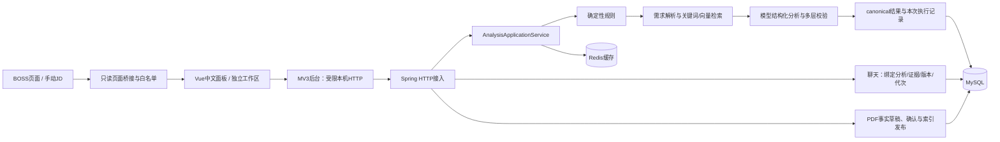

# 当前实现与接口边界

## 组件

Java位于`src/main/java/com/aijob/analyzer`。HTTP层`demo`、规则`rules`、聊天`chat`适配已有`analysis/AnalysisApplicationService`、`workflow`、`profile`、`retrieval`、`llm`、`persistence`和`trace`，没有并列的旧分析服务。

检索使用Lucene关键词召回与持久化向量投影的余弦检索，经RRF融合。向量检索并非独立向量数据库。Redis用于版本化结果缓存，MySQL保存canonical和操作。两者复用来源与本次计算分开记录。

## HTTP契约概览

| 功能 | 接口 |
|---|---|
| 健康与固定用户 | GET `/api/health`、`/api/session` |
| 当前画像 | GET `/api/profile/current` |
| PDF | POST `/api/profile/resume/upload`，multipart `file` |
| 导入状态和事实 | `/api/profile/imports/{id}`、`/{id}/facts`、`/{id}/structure`、`/{id}/confirm`、`/{id}/retry` |
| 文本补救 | POST `/api/profile/imports/text` |
| 规则 | GET `/api/rules/current`、`/capabilities`；POST `/validate`；PUT `/api/rules` |
| 岗位快照 | POST/GET `/api/jobs`；GET `/api/jobs/{id}` |
| 分析 | POST/GET `/api/analyses`；GET `/api/analyses/{id}`、`/{id}/trace`、`/{id}/evidence` |
| 聊天 | POST `/api/chat/messages`；GET `/api/chat/messages/{id}`、`/api/chat/history`；DELETE `/api/chat` |

详细字段以Controller、`RuleModels`、`DemoModels`、聊天模型及`extension/lib/contracts.ts`为准。

规则保存带`expectedVersion`，分析带`clientRequestId/jobSnapshotId/expectedProfileVersion/expectedRuleVersion`。聊天带`clientRequestId/jobSnapshotId/analysisId/question/expectedGeneration`，显式比较另带分析ID；相同请求标识不同内容冲突。清空仅原子推进聊天代次，不修改其他历史。

## 一致性与边界

- 岗位快照规范化并生成指纹，不原地修改。画像导入各阶段分离，事实确认和索引成功后才发布。
- 规则v0仅在没有保存行时合成；v1+即使全部关闭也是用户已保存值。前端建议不自动保存，不变成简历事实。
- 分析冻结画像、规则、模型/提示词/Schema及检索依赖；旧结果保留原版本，变更后判断过期。证据端点读取原分析绑定的画像。
- 硬拒绝在检索/LLM前结束；UNKNOWN继续并要求确认，SOFT不触发硬拒绝。失败及降级与成功分析分开。
- 聊天使用有界近期相关历史和证据，普通问答只取当前分析相关上下文；不把模型建议升级为候选人事实。
- 标签页的岗位和原请求标识存在扩展本地；用户规则、画像、消息以MySQL为准。页面代次、岗位绑定和清空代次共同阻止晚返回覆盖当前界面。
- 页面桥只传岗位白名单，不暴露模型配置。扩展后台限制目标回环地址和路径；Markdown禁止原始HTML并过滤危险链接。Trace经过既有安全边界和业务隔离写入。

主程序只装配真实Provider；确定性启动器位于`src/test`，不会进入生产JAR。配置`provider-mode=TEST`本身并不能将真实Provider替换为测试实现，必须使用TEST启动脚本。
